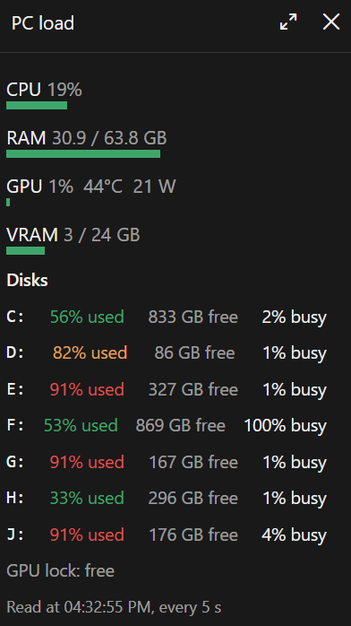

# sysload

A Claude Code mod that shows the live load of the PC it runs on in a small pane beside the chat:
CPU, RAM, GPU utilization, temperature and power, VRAM, and, in the expanded pane, every fixed
disk with its used space, free space and how busy it is. It refreshes every 5 seconds. Useful
when you run local models next to Claude Code and want to see at a glance whether the GPU or
memory is the bottleneck.



The pane opens by itself as a small widget in the desktop app; expand it to see the disks. Type
`/sysload` to open it again after closing it. Bars turn amber from 70% and red from 90%.

The labels follow the Windows language: Polish when the system culture is Polish (`pl-*`),
English for every other culture. The time of the last reading uses the same language. To pick
the language yourself, kept across sessions:

```
/sysload lang en
/sysload lang pl
/sysload lang auto
```

## Requirements

- Windows 10 or 11 (CPU, RAM and disks are read with PowerShell and CIM).
- An NVIDIA GPU with `nvidia-smi` on the PATH, which the NVIDIA driver installs. Without it the
  GPU and VRAM rows say there is no reading and everything else still works.

Readings stay on your computer: the mod runs `nvidia-smi` and one PowerShell query locally and
sends nothing anywhere.

If [Ollama](https://ollama.com) runs on the PC, the pane adds a "Local model" line: the model
Ollama holds in memory and how fast it generates, in tokens per second. While a request is
generating it shows the speed of the last 3 seconds; afterwards, the speed, length and age of the
last finished request. The expanded pane adds the prompt reading speed, the share of accepted draft
tokens when the model uses speculative decoding, and the last speed of every model seen so far. The
mod reads the last 128 KB of Ollama's own log (`%LOCALAPPDATA%\Ollama\server.log`) and its local
`/api/ps` endpoint; it sends no requests to the model, so the readings cost nothing. The speed
lines come from Ollama's llama.cpp runner; a model on a runner that writes no such lines shows only
its name.

The expanded pane also has a "GPU lock" line. It reads the lock directory of a personal
delegation setup (`~/.claude/local/.gpu.lock`) and shows "free" when that directory does not
exist, which is the case on any other machine.

## Install

At the prompt of a Claude Code terminal session:

```
/plugin install sysload --marketplace Juskus/claude-sysload
```

Answer `y` to add the marketplace, then pick a scope (user scope loads it in every session).

From a shell:

```
claude plugin install sysload --marketplace Juskus/claude-sysload
```

In the desktop app, where `/plugin` does not run: click + next to the prompt box, then Plugins,
Add marketplace with `Juskus/claude-sysload`, then Add plugin.

## Cost

Each refresh starts PowerShell once, which takes about two seconds of one CPU core. To refresh
less often, change `PERIOD_MS` in `hooks/register.tsx`.

## License

MIT
